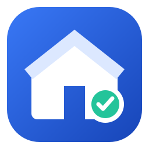

<div align="center">



# Rerum

**Sistema desktop local para gestão patrimonial, financeira e de locações de imóveis**

[](https://go.dev)
[](https://wails.io)
[](https://svelte.dev)
[](https://www.typescriptlang.org)
[](https://sqlite.org)

</div>

---

## Visão Geral

O **Rerum** administra patrimônio imobiliário de aluguel com foco em privacidade e desempenho: todo o processamento e armazenamento ocorrem localmente, sem serviços em nuvem.

- **Interface**: Svelte 5 + TypeScript `strict`, empacotada pelo Wails v2 (WebView nativa).
- **Backend**: Go (`backend/pkg/`) executado *in-process* via bindings do Wails, sem servidor HTTP nem processo filho.
- **Banco**: SQLite local em modo WAL, valores monetários em centavos inteiros (`int64`).

## Funcionalidades

- **Visão geral**: KPIs, gráficos de receitas × despesas e ROI por imóvel com filtros de período (mês, últimos N dias/meses, ano fiscal, acumulado, personalizado).
- **Central financeira**: cobranças (quitação individual/lote, recibos PDF), livro financeiro (OPEX/CAPEX, rateios, CSV) e débitos com extrato.
- **Patrimônio e locações**: imóveis e empreendimentos (cadastro em lote), inquilinos, contratos, renovações e parcelas automáticas.
- **Relatórios e IRPF**: ROI bruto/líquido por período, Carnê-Leão mensal e informe por inquilino.
- **Dados**: backup completo (.zip com manifesto SHA-256), restauração segura, importação de planilha Excel.
- **Produtividade**: paleta `Ctrl+K`, atalhos (`F5`, `Ctrl+1..8`, `/`), tabelas ordenáveis com colunas redimensionáveis e persistência de filtros.

## Instalação no Linux

Pré-requisitos: **Go 1.27.4+**, **Node 20.19+ (linha 20) ou 22.12+**, Wails CLI v2 (`go install github.com/wailsapp/wails/v2/cmd/wails@latest`) e WebKit2GTK 4.1.

```bash
make dev                # modo desenvolvimento com hot reload
make build              # gera wails-app/build/bin/wails-app
make install-launcher   # compila e instala o app + atalho no menu do sistema
```

O atalho do menu inicia o executável em `~/.local/bin/rerum-app`. O app abre maximizado e usa `$XDG_DATA_HOME/rerum/rerum.sqlite` (por padrão, `~/.local/share/rerum/rerum.sqlite`), com os recibos em `recibos/` ao lado do banco. O executável inclui as migrações SQL e funciona fora do checkout.

Com o app fechado, `make install-launcher` importa automaticamente o banco e os recibos da antiga pasta `data/` quando ainda não existe um banco de usuário. A instalação preserva os arquivos de origem. Para trocar de máquina, exporte um backup completo em **Configurações → Dados**. Instale o Rerum na nova máquina e restaure o arquivo ZIP pela mesma tela. Para importar uma pasta antiga que já contém `rerum.sqlite` e `recibos/`, rode `RERUM_LEGACY_DATA_DIR=/caminho/da/pasta make install-launcher` antes de abrir o app pela primeira vez.

Para desenvolvimento, `make dev` e `make backend` usam um banco temporário por padrão. Use um caminho absoluto em `RERUM_DB_PATH` para reutilizar um banco isolado.

As preferências de interface ficam em `$XDG_CONFIG_HOME/Rerum/preferences.json` (por padrão, `~/.config/Rerum/preferences.json`). Guarde os bancos, recibos e arquivos de backup fora do checkout.

## Qualidade

```bash
make test        # testes Go (backend e wails-app)
make lint        # gofmt + go vet
make typecheck   # svelte-check (TypeScript strict)
```

Os testes usam SQLite temporário e dados sintéticos; a base real nunca é tocada.

## Estrutura

```
rerum/
├── backend/            # Motor Go: domínio, storage SQLite, API, importador
│   ├── cmd/            # CLI auxiliar (backup/restore/servidor local opcional)
│   └── pkg/migrations/sql/  # Migrações SQL incorporadas no executável
├── wails-app/          # Aplicativo desktop (Wails + Svelte/TypeScript)
│   └── frontend/src/   # páginas, componentes, diálogos e lib tipada
├── packaging/          # Template do atalho .desktop
├── scripts/            # Instalador do app/atalho
└── go.work             # Workspace Go (backend + wails-app)
```
